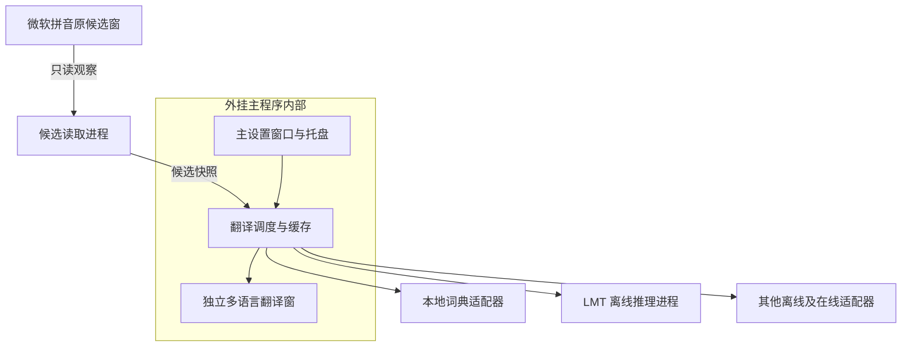

# 微软拼音翻译外挂架构设计

版本 0.3  日期 2026 年 10 月 14 日  状态 实验实现与待验收边界

本项目是一个伴随微软拼音运行的 Windows 桌面工具。微软拼音继续负责拼音输入、中文候选、排序、用户记忆和中文上屏；外挂读取当前可见候选，在原候选窗旁显示外语释义。默认使用 LMT-60-1.7B Q4_K_M 离线推理，并由本地词典兜底。用户可设置不同目标语言，也可同时并排查看不同来源和不同语言的结果。

本方案不开发、安装或注册新输入法，不替换微软拼音，不接管键盘或中文提交。独立翻译窗与后台托盘属于外挂自身。退出、暂停或发生故障时，微软拼音继续正常使用。

首个技术验证点是能否可靠读取目标 Windows 版本上的微软拼音候选。Windows UI Automation 支持访问已暴露的界面元素 [R1]，但公开资料不能证明每个版本的微软候选都完整暴露。本设计将候选读取列为先验证再开发完整产品的条件，不把尚未验证的读取能力当作事实。

## 1 范围与主要决策

| 项目 | 决策 |
| --- | --- |
| 产品形态 | 微软拼音旁的翻译外挂，单独的桌面程序 |
| 输入法 | 继续使用系统微软拼音，不修改其候选和输入习惯 |
| 候选来源 | 优先 UI Automation，只观察当前可见候选 |
| 读取限制 | 当前只调查并使用 UIA，用户暂不增加 OCR |
| 翻译 | LMT-60-1.7B Q4_K_M 离线推理，本地词典兜底 |
| 语言 | 默认中文到英文，可配置多目标语言同时显示 |
| 显示 | 独立、不夺焦点、默认点击穿透的翻译窗 |
| 扩展 | 候选读取、词典、在线模型、离线模型均有适配器边界 |
| 设置 | 中文主设置界面、系统托盘、登录启动与资源策略 |
| 数据 | 候选只读原范围；正文功能默认关闭，开启后仅读活动选区或光标所在句，不读全文/剪贴板/密码 |

TSF 在本项目中属于微软拼音的内部输入链路背景，不作为外挂的候选生成引擎。ITfUIElementSink 和候选接口可供处于相应 TSF 环境的应用与输入法协作，但不能据此假定普通后台程序能订阅所有应用的微软候选 [R3]。首版不采用 DLL 注入、私有微软拼音接口、逆向候选生成或另建拼音词库。

比较三条路线后，选择 UIA 读取加独立翻译窗：它保留微软拼音体验且开发范围最小。OCR 仍保留原输入法，但多出识别误差与截图处理；只作为读取适配器的备选。自有 TSF IME 或修改小狼毫会涉及输入法产品本身，超出本项目范围。

## 2 总体架构



首版使用三个进程：外挂主程序、候选读取进程和 LMT 推理进程。调度器作为主程序内的后台模块运行，不额外引入 Windows 服务或独立 Broker 部署。模块之间保留清晰接口，以后有需要再拆分进程。

| 组件 | 职责 | 建议实现 |
| --- | --- | --- |
| DesktopHost | 托盘、主设置、翻译窗、生命周期管理 | C# WPF 与受支持的 .NET LTS |
| CandidateReader | 发现候选窗，读取候选与位置，发布快照 | C# 与原生 UIA COM 接口 |
| TranslationManager | 去重、缓存、取消、超时、多源及多语言调度 | 主程序后台模块 |
| ModelWorker | 加载并运行 LMT，报告健康状态 | 固定版本 llama.cpp；默认 CUDA GPU 优先，初始化失败回退独立 CPU 运行时 |
| Provider Adapter | 统一词典与各类推理源的请求和结果 | 内置适配器或外部适配器进程 |

UIA 调用使用专门的 COM MTA 线程，避免占用设置和翻译窗的 UI 线程，订阅与取消事件在同一线程管理 [R2]。将读取器放到独立进程，是为了在界面读取卡住时可停止并重启它。所有跨进程消息只传普通数据，不传 UIA 或目标应用的 COM 对象。

主程序与读取器通过当前用户命名管道连接；同一登录会话只启动一套外挂。模型作为子进程运行，仅监听本机回环地址并使用启动时生成的认证令牌。多个语言共用一个模型实例，不为每种语言复制权重。

## 3 微软候选读取

CandidateReader 先通过窗口与可访问性事件发现候选界面，再在限定的候选容器内读取文本、编号、顺序及屏幕边界。进程身份、窗口关系、可见状态和内容结构共同用于识别，不能只凭某个窗口标题或未验证的固定类名。输入目标应用与微软候选界面的宿主进程可能不同，适配器必须正确关联当前前台环境。

优先通过 UIA 的结构与属性变化事件更新。SetWinEventHook 的 WINEVENT_OUTOFCONTEXT 可作为显示、隐藏和前台变化的辅助通知，回调运行在外挂进程内 [R4]；它是界面事件观察，不是键盘钩子，也不自动提供候选文本。事件回调只排队工作，禁止进行长时间推理。

本机实测入口为原生 COM UIA3 的 desktop subtree MenuOpened：事件节点的有界 Raw 父链可取得未被顶层窗口枚举发现的系统宿主 HWND，再进入既有托管扫描。候选项的编号和文字可能只存在于 RawView；读取只限已认证系统宿主和候选容器，不能遍历应用正文。根因和证据见 [UIA 调查](candidate-reading-next-step.md)。

初次发现可扫描桌面的顶层元素，随后只查询已识别的候选子树，避免反复遍历整个桌面。候选可见时使用限频检查补充可能遗漏的事件，初始间隔 50 ms；隐藏时停止候选扫描并降低发现频率。UIA 查询支持缓存和有界范围 [R1]。

读取器发布 CandidateSnapshot，包含 sessionId、snapshotId、generation、候选窗矩形、读取方式、候选列表及选中项。每个候选有稳定 ID、中文文本、可见序号和可选矩形；未暴露的选中项或页码标记为未知，不编造。只翻译当前可见候选，不尝试获取隐藏的完整词库。

候选文字、顺序、窗口身份或前台环境变化时增加 generation。微软候选窗关闭、切换应用或进入不可读取环境时立即使快照失效并隐藏翻译窗。文字相同但窗口已换代时也不能复用旧界面身份。

UIA 页不是原子更新：同页连续一致读取且间隔至少 50ms 后才发布。等待确认使用 `Updating` 消息，取消旧翻译但保留旧显示；候选真正关闭使用 `CandidatesClosed`，只清空候选显示和任务；`Hidden` 表示故障并清空候选及正文。两个状态不能混用。Desktop 和 reader 使用同一构建配套发布。

候选无法可靠读取时显示“当前环境无法读取候选”，保留微软输入行为。若 UIA 在目标系统上未通过验证，可评估局部 OCR 适配器：仅截取已确认的候选窗区域，保留编号和文本对应关系，对含糊识别拒绝显示，不保存截图。OCR 不默认启用，不读取应用正文，不能从“能截图”推导出“能准确识别”。若两种方式都不可靠，该环境列为不支持，不扩大为新输入法项目。

## 4 翻译窗与并排布局

翻译窗显示在微软候选窗下方或旁边，通过候选窗矩形定位，不能覆盖原有候选和输入内容。默认使用不激活窗口和点击穿透，数字键、空格、鼠标点击候选仍完全交给微软拼音。翻译窗不修改、排序、选择或提交微软候选。

为避免把微软横向候选布局误当成可控制的布局，外挂采用独立表格：每行重复显示当前候选中文及其可见序号，每列显示一个指定来源和目标语言。翻译结果与候选中文同时可见，用户无需猜测对齐关系。界面中的示例译文只说明布局，不代表模型实测。

| 候选中文 | LMT 英文 | LMT 日文 | 词典 A 英文 |
| --- | --- | --- | --- |
| 1 保险 | insurance | 保険 | insurance / safe |
| 2 支持 | support | 支持 | support / back |
| 3 苹果 | apple | りんご | apple |

每列拥有 columnId、目标语言、主来源、兜底链、提示词覆盖、颜色和列顺序。同一模型可显示不同语言，同一种语言可并排显示不同来源。用户明确添加列组合，不自动创建所有来源乘以所有语言的组合。

主源加兜底模式下，每种目标语言可显示一个综合列。模型未返回时显示同语言词典，并标注实际来源；模型成功后替换。对比模式保留各来源列，相同译文不合并。没有日文词典时，日文推理失败显示无释义，不能把英文填进日文列。

默认来源颜色为离线模型蓝色、词典绿色、在线模型紫色。用户可为来源或单列分别设置浅色及深色颜色，列配置优先；列标题始终包含来源和语言。高对比度模式使用系统颜色与文字标签。缓存跟随原来源，不作为新的来源列。

默认跟随 Windows 应用颜色模式：只读 `HKCU\Software\Microsoft\Windows\CurrentVersion\Themes\Personalize\AppsUseLightTheme`，不是可独立设置的 Windows shell 模式；字段见 [微软主题设置参考](https://github.com/MicrosoftDocs/windows-dev-docs/blob/docs/hub/apps/develop/settings/settings-common.md#personalization---colors)。`WM_SETTINGCHANGE`、`WM_THEMECHANGED`、`WM_SYSCOLORCHANGE` 通知只触发就地重着色，不隐藏、重建页面或重载来源。读取失败回退手动 `Dark`；`FollowSystemTheme` 缺省为 true。背景、边框、候选文字和释义同时切换；列文字对比度不足 4.5:1 时回退前景色，高对比度始终采用系统颜色。默认现代微软拼音的视觉一致性仍需现场核对，不承诺所有旧模式/自定义皮肤像素一致。

内容层 `OverlayContent` 不创建 HWND。首屏可以增量显示等待；后续快照保留旧页直到词典快查后各单元格收到首个状态，再整体替换 Grid。模型无词典命中时发 Pending，允许提交新页但不算任务终态，期限仍须收尾；模型完整译文原位补齐。新快照或 Updating 撤销未完成候选页，CandidatesClosed 清候选，Hidden 清空候选及正文。缓冲期间旧结果不能改写旧页。

窗口支持 Per Monitor DPI、多显示器工作区和位置偏移。默认最多读取 10 个可见候选、初始 2 个释义列（可配置），宽度限制为当前工作区的 80%；更多语言时省略长译文并可按行折行，原候选窗始终保持可操作。等待、无释义、超时和异常分别显示，详情通过设置窗口查看，首版不增加翻译窗内的交互控件。

### 正文悬浮框

前台窗口身份通过最多 64 层 Raw 父链的原生窗口核对 GA_ROOT，不读取祖先正文；深层网页布局不应被原 12 层限额误拒绝。该身份预算与 Provider 借用父级接口的范围预算分开。没有文本接口的顶层 Window，仅在 GetGUIThreadInfo 成功且窗口、原生 focus、caret 均等于当前前台时报告 UnsupportedControl；不由原生 caret 推断可读正文。

句子和选区各有独立开关，默认关闭。统一 `TextReader.ReadAsync` 在 reader MTA 中串行执行 `TextTargetResolver → TextProviderRouter → TextProvider → CapturedText → SentenceExtractor`；非空选区优先，句子使用活动 caret。`CapturedText` 是最多 514 个 UTF-16 字符的局部窗口，最终原文和完整选区最多 256 字符；不知道 caret 偏移时拒绝猜测位置。

UIA 自身模式使用 `DocumentRange`，借用祖先模式必须使用 `RangeFromChild(focusedElement)`。caret 必须活动且退化，caret 和整个选区在读取前都必须属于同一 scope；扩展范围只能夹紧到该 scope，失败不能退回父文档全文。Chromium 的空边界位置只在同一个聚焦 Edit 内、间隙经两次确认无文字时对齐回原 scope，不扩大范围。contenteditable 的 enclosing element 可为内部文字节点，归属通过最多 8 层 Raw 父链核对原 Edit，途中密码或其他 Edit 立即拒绝。Group 仅在选区功能开启时可作为目标，空选区不能进入 caret/句子路径。该模式的祖先文本接口查找最多 64 层，其他角色仍 8 层，途中遇密码或前台原生根即停止；查得接口后仍以原 Group 的子范围限定读取，不将查找深度当作正文范围。读取前后重新核对目标、范围及位置。兼容 Provider 使用同一个已验证目标：IA2 只查询焦点自身的文本对象，Scintilla 只对真实焦点 HWND 使用有超时的 scalar getter；UTF-8 字节转为局部 UTF-16 偏移。MSAA 仅辅助身份与角色识别，不使用 accValue 正文兜底。新 Provider 的具体应用支持仍以现场验收为准。

组合状态采用 reader 已验证或正在确认的微软候选状态，各 Provider 一致；不把浏览器保留的历史 `GetActiveComposition` 范围当作持续输入。该候选信号的具体应用和过渡场景仍须真实 IME 验收。

`TextStatus` 与候选状态分开，携带 Provider、scope、类名、角色、会话/版本、耗时和数值错误码。正常无目标或无活动选区时，取消旧正文任务、清空快照并收成圆圈，迟到译文不得恢复旧内容；接口缺失、范围无效、权限拒绝和超时显示各自原因。默认诊断不含正文、Name、Value、网址、标题或异常 Message。正文失效只清正文，候选故障仍清空全部。密码、不支持或失效目标拒绝读取，不用全文或剪贴板兜底。

`TextTranslationCoordinator` 保留最新会话/目标/模式/版本，300ms 稳定等待、1000ms 合并上限，3000ms 请求期限。复用候选来源的单个生成槽，在请求边界优先最新正文；不进候选缓存或在线来源。正文使用完整文本模板和独立 128 输出，512 context 下最多 368 输入、16 控制 token。超预算、输出达到长度上限明确失败，不静默截断。模型加载中显示状态，加载完成只刷新仍有效的加载中快照。

独立 `TextOverlayWindow` 默认右下角 420×180 DIP，标题可拖、边缘可缩，释放后保存几何；无目标为 28 DIP 圆圈。窗口保留鼠标命中能力，使用非激活样式及 WM_MOUSEACTIVATE 拒绝激活，不能复制候选窗的整窗点击穿透。两框共享主题、字体 14 DIP 和展开圆角 8 DIP。实际应用、焦点、范围与跨屏验收见 [正文测试](text-translation-testing.md)。

## 5 调度与响应阈值

翻译调度不等待或干预微软输入。收到新候选快照后，可以立即查缓存和词典；模型请求等待候选稳定阈值。快照再变化则重新计时、取消旧任务并清除过期译文。这里的“停止输入”以观察到的候选变化近似，外挂不记录按键，不能宣称知道每个真实按键发生的时间。

本地词典命中和缺词都在词典查询后立即发布，词典列不进入模型稳定等待。候选变化时撤销旧任务，旧页仅作为完整显示缓冲保留，不能把其释义关联到新页候选。

| 设置 | 初始值 | 行为 |
| --- | --- | --- |
| 候选稳定阈值 | 120 ms | 最后一次可见候选变化后开始模型请求 |
| 快照结果期限 | 1500 ms | 队列、分词与推理总预算 |
| 本地推理无进展 | 800 ms | 执行后无首 token 或无后续 token 则超时 |
| 在线无进展 | 2000 ms | 独立来源设置，仍受快照总预算限制 |
| UIA 单次读取看门狗 | 500 ms | 超过后失效该读取并重启读取器 |
| 取消宽限 | 1500 ms | 断开 SSE 后确认单槽空闲；固定版连接轮询为 1 秒 |
| 模型心跳失联 | 5 秒 | 健康通道失联阈值 |
| 模型加载超时 | 60 秒 | 加载及预热独立预算 |
| 词典慢查询 | 50 ms | 跳过慢来源，其他来源继续 |
| 模型空闲卸载 | 10 分钟 | 无任务时释放，0 表示保持驻留 |

各参数可独立配置并校验合理范围。有效期限为来源期限和快照期限中的较早者；当在线设置为 2000 ms 而快照为 1500 ms 时，页面明确显示有效期限为 1500 ms。模型加载不套用候选翻译的短期限，加载期间词典仍可显示。

默认每个模型只用一个生成槽位。优先当前选中候选；选中项未知时按可见顺序。对一个候选轮转各目标语言，再处理其余候选，避免先翻完整页英文才开始日文。可设置优先语言，多语言增加任务量但不自动增加并发或复制模型。

每个活动会话只处理最新快照，正常输入不自动重试。来源完整短译文校验通过后交给内容层：首屏可增量显示，已有页面时遵循上述整页替换规则；不显示未经校验的 token 流。旧快照、不同列或不同语言的结果均不能写入当前单元格。

取消先使旧结果失效，再释放 HTTP/SSE，并在宽限内通过已认证 /slots 确认唯一槽位空闲。确认成功复用 worker，失败才停止 owned worker；分词前取消不重载。固定 b11077 源码使用 1 秒连接轮询，本机实测原 300ms 不足，默认改为 1500ms；清理等待占用模型槽但不阻塞词典或界面。频繁正常取消不计故障，连续 3 次超时或崩溃后冷却 30 秒，启动最多每分钟 2 次。

## 6 翻译来源与词典扩展

统一来源类型为 local_dictionary、local_model 和 online_model。Query 接收候选列表及一个目标语言；主调度器把多语言快照分拆为来源任务。接口接收批量候选不等于要求模型一次生成批量 JSON。

| 接口 | 定义 |
| --- | --- |
| Describe | 来源身份、版本、语言对、能力与配置字段 |
| ValidateConfig | 路径、参数、提示词及凭据引用检查 |
| Start 与 Stop | 加载、卸载和生命周期状态 |
| Query | 逐候选增量结果和任务完成事件 |
| Cancel | 取消请求并报告后端计算是否已停止 |
| Health 与 Metrics | 健康、进度、延迟和资源使用 |

能力字段包含 supportsBatch、supportsPrompt、supportsSystemRole、supportsHardCancel、maxInputTokens 和 supportedLanguagePairs。语言清单与支持方向分开，覆盖 60 种语言不代表支持所有任意语言对。来源不支持所选方向时，配置页拒绝该组合，不留到输入时随机失败。

首版实现 LMT llama.cpp 适配器与 SQLite 词典适配器，预留其他本机 HTTP 模型、在线兼容接口及外部适配器进程。添加来源实例不改候选读取器或翻译窗；新增厂商协议只增加来源适配器。在线来源默认禁用，离线失败不会自动联网。

本地词典支持 UTF-8 TSV 导入并转换为统一 SQLite 索引。词条包含中文词头、目标语言、释义、可选词性及别名；manifest 包含版本、语言对、出处、许可证和校验值。默认随包中英词典，其他语言通过相应词典包扩展。采用明确规范化和精确匹配，未命中与查询失败分开，默认最多显示两个短词义。

增加词典格式时扩展导入器，复杂查询来源可实现运行时适配器。词典构建与索引发生在设置阶段，完成后原子切换只读包。随包词库须确认可分发许可。翻译缓存与静态词典分别管理，不把 AI 结果自动混进词典。

## 7 LMT 离线推理与提示词

固定采用官方 NiuTrans/LMT-60-1.7B 翻译版本，不采用 Base 检查点。官方配置为 Qwen3ForCausalLM，公开用法采用翻译提示词和模型 chat template [R5][R6]。Windows 推理优先选择固定版本 llama.cpp，部署使用固定社区 GGUF Q4_K_M；保存原始 revision、分词器、模板、转换器版本与 SHA256。转换及输出一致性须实际验证。 新用户准备脚本默认下载固定 revision/hash 的 mradermacher 社区 Q4_K_M（模型卡声明来自该非 Base 模型），放在 exe 同级 LLM，允许自定义目录并生成完成清单。社区模型卡未注明原始 safetensors commit，不能把 GGUF revision 冒充官方原始 revision；自建转换路线保留。

默认 Q4_K_M 是用户明确选择的权重量化；保留 Q8_0/Q6_K/Q5_K_M 的手动选择，不自动换精度。KV 默认 FP16，不标记为 W8A8。以后更换量化或运行时，只更换模型适配器，不影响微软拼音或候选读取。

| 参数 | 初始配置 |
| --- | --- |
| 单槽总上下文 | 512 tokens，包含模板、输入、输出和控制 token |
| 输入预算 | 实际分词后不超过 448 tokens，剩余量留给输出及控制 |
| 单候选输出 | 32 tokens，可按语言和来源调整至 64 |
| 解码 | greedy 或 temperature 0，首版不使用 beam search |
| 并发 | 1 个生成槽位，各语言共享 |
| 设备 | 默认 NVIDIA CUDA GPU 优先，初始化失败回退独立 CPU；可只用词典 |
| 显存规划 | 约 2 至 3 GiB，最终按实机测量 |

1.7B 级别的 Q8 权重约为 1.7 GiB 的数量级。按官方 28 层、8 个 KV 头和 128 维头配置，单槽 512 token 的 FP16 KV 理论约 56 MiB [R6]；计算缓冲、非量化张量和 CUDA 环境另计。短上下文不会消除运行时开销，也不代表已经测得固定显存或延迟。

提示词先按来源保存，再允许每个语言列覆盖。支持 candidate、source_language_name、target_language_name；使用规范语言代码映射成模型接受的语言名称。模板有版本和变量白名单，不支持脚本、任意文件读取或在缺少数据时伪造上下文。

```text
Translate this {{source_language_name}} word or short phrase into {{target_language_name}}.
{{source_language_name}}: {{candidate}}
{{target_language_name}}:
```

LMT 默认逐候选、逐目标语言生成，适配器包装正确的 chat template，不假定模型能遵循批量 JSON 指令。通用指令模型如验证支持结构化批量输出，可使用另一模板和解析器。设置页提供编辑、变量说明、恢复默认、样例测试、实际 token 数及原始输出查看。

没有上下文时，多义词允许给出常见词义或两个短词义，不保证能判断当前语义。整句翻译成绩不能证明候选释义质量。输出为空、结构损坏、包含思考过程或超过安全上限时转同语言兜底；长但有效的译文可省略显示。语言检查按目标配置，不能因日文含汉字而判错。格式校验不能证明语义准确。

模型加载和预热独立进行。显存不足时显示原因并提供释放模型、CPU 或词典模式，不自动改成更低量化或在线来源。提示词超出实际 token 预算时明确提示，不截断候选中文。切换模型先卸载旧模型，避免默认同时驻留两份权重。

## 8 主设置界面与后台托管

主窗口使用中文分类设置，首页显示总开关、微软候选读取状态、设备、模型状态、已启用语言列和最近延迟。关闭窗口默认隐藏到托盘，读取及翻译按配置继续；显式退出会停止读取器和推理进程，微软拼音继续运行。

| 页面 | 内容 |
| --- | --- |
| 概览 | 总开关、候选可读状态、当前模型、语言与异常 |
| 候选读取 | UIA 状态、适配器版本、诊断、可选 OCR、应用启停列表 |
| 响应与资源 | 稳定阈值、无响应超时、总期限、候选数、预热和卸载 |
| 语言与来源 | 目标语言、来源实例、语言对、主来源及同语言兜底 |
| 提示词 | 按来源和语言列编辑、测试与版本管理 |
| 词典 | 导入、启用顺序、重建索引、词条测试和出处 |
| 翻译窗 | 来源及语言列、颜色、宽度、位置偏移与实时预览 |
| 后台与数据 | 登录启动、关闭到托盘、缓存、日志和配置导入导出 |

托盘提供打开设置、暂停或恢复、临时只用词典、加载或释放模型、重启候选读取、重启翻译模型和退出。暂停立即隐藏翻译窗并取消任务；临时词典模式继续读取候选，停止模型任务；登录启动与启动预热分别可设。

配置写入采用校验、临时文件和原子替换。保存成功增加 settingsRevision；颜色、位置和触发参数即时生效，模型路径、设备和上下文变化重新加载 Worker。无效参数保留上一份有效配置。读取适配器变化使旧快照失效，切换目标语言不接收旧列译文。

## 9 协议 配置与缓存

候选读取适配器接口为 Start、Stop、SubscribeSnapshots、Health 和 DescribeCapabilities。结果是可验证的候选快照，能力明确说明能否提供选中项、序号和单词矩形。读取适配器与翻译来源是两个独立扩展点，OCR 不属于翻译源。

IPC 使用长度前缀 UTF-8 JSON，protocolVersion 为 3，旧版本明确拒绝；Desktop 与 reader 必须使用同一配套包。单条消息上限 64 KiB，按用户及登录会话隔离并校验连接身份。模型通过本机接口调用，主程序控制子进程生命周期。输入链路里没有外挂的 DLL 或 COM 输入法注册项。

TranslateRequest 包含 requestId、sessionId、snapshotId、generation、settingsRevision、剩余预算、来源列及候选数组。候选 ID 与中文内容绑定；ProviderResult 必须携带 columnId、targetLanguage、providerId、来源版本、候选 ID、原始内容摘要、释义、状态和耗时。只有快照、列、语言及版本均仍有效时才显示。

```json
{
  "protocolVersion": 2,
  "requestId": "r-17",
  "sessionId": "s-3",
  "snapshotId": "v-9",
  "generation": 24,
  "settingsRevision": 6,
  "remainingBudgetMs": 1500,
  "sourceLanguage": "zh",
  "columnIds": ["lmt-en", "lmt-ja", "dict-en"],
  "candidates": [{"id": "k-2", "text": "保险"}]
}
```

结果状态为 Ready、NotFound、Timeout、Cancelled、InvalidOutput、Unavailable 和 Skipped。状态不伪装成译文。源返回缺少 ID 或错误语言时拒绝，不仅按数组下标绑定候选。预算在各进程用单调时钟计算，翻译窗自身也检查快照失效和最终期限。

配置 schemaVersion 与 settingsRevision 分开，至少包含 capture、response、providers、columns、display、resources、privacy 和 startup。每列记录 sourceId、targetLanguage、fallbackSourceIds、promptOverride、colorOverride、displayOrder 和 width。语言代码统一用 BCP 47，厂商特殊代码由适配器映射。

缓存键包含中文规范化文本、语言方向、来源版本、模型量化和提示词版本，默认有限容量内存 LRU。持久缓存为显式开关，不记录输入历史；修改模型、模板或词典版本后进入新的缓存命名空间。在线密钥只保存凭据引用，配置导出不含密钥。

## 10 故障与数据边界

| 情况 | 外挂行为 | 微软拼音 |
| --- | --- | --- |
| 候选读取失败或卡住 | 隐藏旧结果，报告不支持或重启读取器 | 正常输入 |
| 原候选窗关闭或前台切换 | 隐藏翻译窗并取消旧任务 | 正常输入 |
| 模型未加载或超时 | 显示同语言词典或状态 | 正常输入 |
| 所有来源失败 | 无释义，不生成伪译文 | 正常输入 |
| 某语言方向不可用 | 仅该列报告不可用 | 正常输入 |
| 主程序退出或崩溃 | 外挂消失，模型由生命周期机制清理 | 正常输入 |

每个来源独立检测健康和生成进展。读取器卡住不拖住设置，模型卡住不拖住候选读取。后台异常通过托盘和设置页呈现，不在每次按键时弹窗。无法验证当前候选身份时宁可隐藏，也不把过期释义放在新候选旁。

默认只处理当前可见候选。正文功能独立且默认关闭，显式开启后只读取前台活动目标中的选区或光标所在句，不访问全文、密码、剪贴板、按键历史或微软用户词库。诊断默认记录耗时、错误码和资源统计，不记录候选原文、完整提示词或截图。原始内容调试需显式打开并可清除。开启在线来源时说明发送的候选及目标语言，离线失败不自动联网。

第一版针对普通桌面环境，不承诺管理员窗口、安全桌面或未验证的系统版本。高权限访问、UIAccess 和截图权限如确有需要，须另做部署设计；不把“管理员常驻”当作默认解决方式。模型和词典文件保留来源、版本、校验值及许可通知。

## 11 开发顺序与验收

开发顺序由候选读取决定。先在用户实际 Windows 版本上完成只读可行性验证，再接模型、翻译窗和完整设置。这能把投入限制在外挂范围内，避免为读取失败另造输入法。

| 阶段 | 交付内容 | 通过条件 |
| --- | --- | --- |
| 候选读取验证 | 小型 UIA 诊断程序 | 正确读到可见词、顺序、窗口及关闭事件 |
| 离线最小闭环 | 读取快照、词典、LMT、独立翻译窗 | 不夺焦点、不接管输入，旧结果不串行 |
| 设置与多语言 | 托盘、阈值、来源、模板、语言列和颜色 | 关窗继续，语言与来源独立生效 |
| 扩展与稳定性 | 第二词典、模拟推理源、故障恢复 | 无需更改微软输入法，契约检查通过 |

候选读取验证覆盖普通输入、连续快速键入、翻页、删除、数字选择、鼠标选择、候选关闭及切换应用；至少测试记事本、浏览器、Office、Electron 与终端。记录 Windows build、微软拼音设置、读取结构与失败环境，不能从一个应用通过推断全部兼容。快速变化时可跳过短暂快照，但只要显示译文，中文和编号必须一致。

UIA 热状态目标为稳定候选在 100 ms 内形成正确快照，翻译窗在快照失效后 100 ms 内隐藏；这些是待测目标。不得通过扩大访问范围、接管键盘或提交文本来掩盖读取缺陷。UIA 未通过时仅评估可选 OCR；OCR 需单独测候选识别及对应准确性，不将模糊识别当作成功。

模型评估使用至少 200 个普通词、短语、多义词、专有名词和词典未命中样本。英文普通词与短语的初始目标为至少 95% 人工判定可用，各目标语言分别评估；不把英文结果推广到所有语言。对照原始权重与 Q8_0，不宣称 INT8 无损或把 COMET 当作正确率。

延迟分别测候选读取、翻译调度、首候选完成、本页完成、冷启动、热启动与取消残留计算，报告 p50、p95、p99、超时率及显存峰值。多语言测同源双语言、同语言多源、公平调度、颜色覆盖及同语言兜底，默认预算不够时明确标注跳过。

完整验收还包括多显示器、DPI、浅色深色、高对比度、窗口边界、UIA 卡死、显存不足、模型重启和程序退出。微软候选、用户记忆与中文提交由原输入法负责，本项目不开发这些能力。首版不包含新 IME、Rime 分支、英文上屏、模型训练或插件商店。

## 12 资料与验证状态

本设计于 2026 年 10 月 10 日查阅以下一手资料。Windows 文档说明可访问性接口的一般能力，不能证明特定微软拼音候选可读；模型资料说明公开配置与用法，不能证明短词质量、量化或速度。默认参数、进程划分及显存预算为工程设计选择。

- [R1] Microsoft 获取 UI Automation 元素 https://learn.microsoft.com/en-us/windows/win32/winauto/uiauto-obtainingelements
- [R2] Microsoft UI Automation 线程模型 https://learn.microsoft.com/en-us/windows/win32/winauto/uiauto-threading
- [R3] Microsoft TSF UI-less 模式 https://learn.microsoft.com/en-us/windows/win32/tsf/uiless-mode-overview
- [R4] Microsoft SetWinEventHook https://learn.microsoft.com/en-us/windows/win32/api/winuser/nf-winuser-setwineventhook
- [R5] NiuTrans LMT 1.7B 官方模型卡 https://huggingface.co/NiuTrans/LMT-60-1.7B
- [R6] NiuTrans 官方模型配置 https://huggingface.co/NiuTrans/LMT-60-1.7B/blob/main/config.json
- [R7] llama.cpp server 参数与接口 https://github.com/ggml-org/llama.cpp/blob/master/tools/server/README.md

已按本架构实现首版实验工程，当前实现和自动验证记录见 [implementation-status.md](implementation-status.md)。本机真实 UIA/词典闭环及 Q8/Q4 CPU/CUDA 基础后台验收已完成；完整量化质量、其他环境及新界面现场验收仍未完成。须完成 [Windows 验收](windows-validation.md) 后再判断是否达到稳定产品要求。
